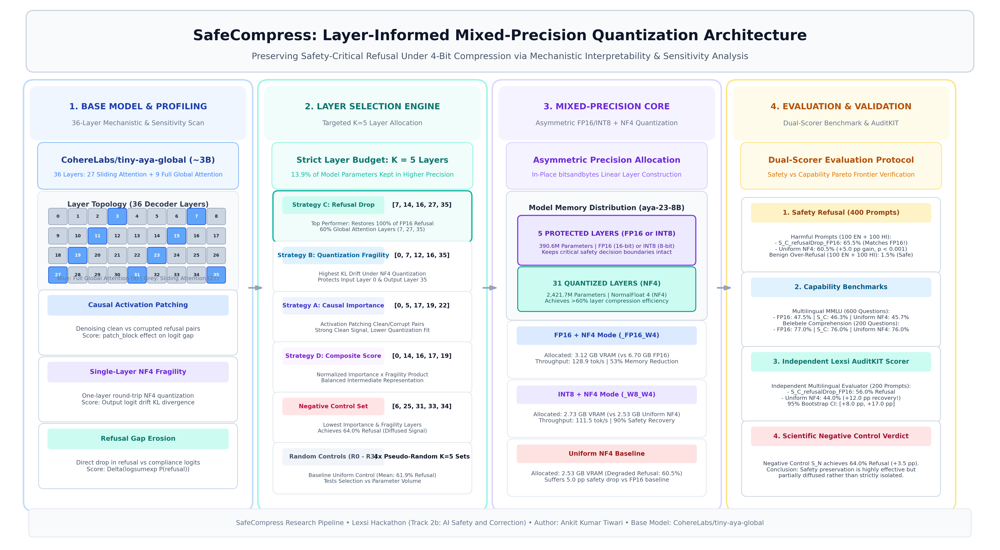
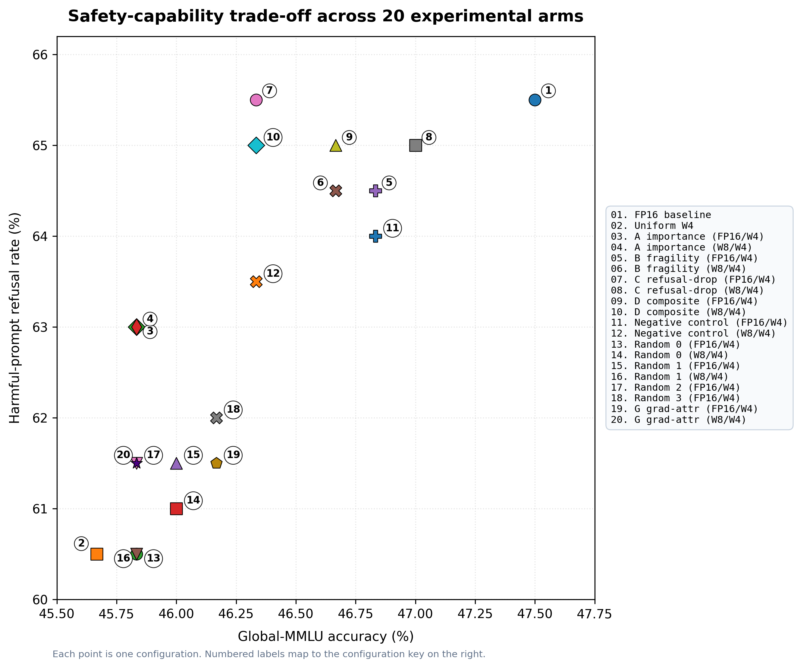
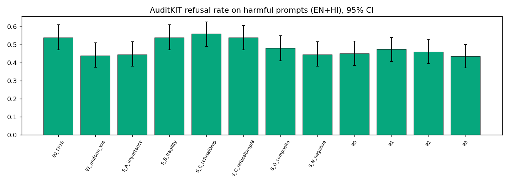

# SafeCompress: Layer-Informed Mixed-Precision Quantization for Safety-Aware Model Compression

**Author:** Ankit Kumar Tiwari  
**Affiliation / Track:** Lexsi AI Safety & Alignment Hackathon (Track 2b: AI Safety and Correction)  
**Base Model:** [`CohereLabs/tiny-aya-global`](https://huggingface.co/CohereLabs/tiny-aya-global) (about 3B parameters, 36 decoder layers)  
**Artifacts:** Model Collection at [`cybertronak/safecompress-safety-aware-tiny-aya-compression`](https://huggingface.co/collections/cybertronak/safecompress-safety-aware-tiny-aya-compression) | Results Dataset at [`cybertronak/layerlab-store`](https://huggingface.co/datasets/cybertronak/layerlab-store)  

> [!NOTE]
> This article documents the final 20-arm published investigation. An earlier preliminary pilot experiment focusing solely on activation-patching in a 12-arm configuration is preserved in `safecompress/ARTICLE.md`.

---

## Abstract

Uniform 4-bit post-training quantization drastically reduces the memory footprint of large language models, but often induces safety alignment degradation—causing models to fulfill harmful requests they refuse at full 16-bit precision. In this work, we propose and evaluate **SafeCompress**, an empirical investigation into *layer-informed mixed-precision quantization*. By keeping a small budget ($K=5$ out of 36 layers, ~14% of the network) in higher precision (FP16 or INT8) and quantizing the remaining 31 layers to NormalFloat 4 (NF4), we test whether refusal mechanisms can be selectively preserved without sacrificing memory efficiency. Across 20 experimental arms on `CohereLabs/tiny-aya-global` evaluated on 400 safety prompts (English and Hindi), 600 multilingual MMLU questions, and 200 Belebele items, we find: (1) Protecting layers identified by refusal logit gap erosion under quantization (`S_C_refusalDrop_FP16_W4`, layers `[7, 14, 16, 27, 35]`) restores harmful refusal to **65.5%**, matching the unquantized FP16 baseline (**65.5%**) and outperforming uniform NF4 (**60.5%**, $+5.0\,\text{pp}$, 95% bootstrap CI: $[+2.5, +8.0]$), while consuming only **3.12 GB** of GPU memory vs. **6.70 GB** for FP16. (2) Independent evaluation using Lexsi's AuditKIT confirms this recovery, showing a $+12.0\,\text{pp}$ refusal gain over uniform NF4 ($56.0\%$ vs $44.0\%$, 95% CI: $[+8.0, +17.0]$). (3) Crucially, an explicit negative control arm protecting the 5 *lowest*-ranked layers on both importance and fragility also achieves **64.0%** refusal ($+3.5\,\text{pp}$ over uniform NF4). This indicates that while mixed precision reliably preserves refusal behaviour, the underlying safety preservation benefit is partially distributed across transformer layers rather than strictly isolated to a single sparse circuit.

---

## 1. Introduction

As frontier language models are adapted for deployment on edge devices, local workstations, and cost-constrained inference infrastructure, post-training quantization (PTQ) has become the de facto compression method. Techniques such as 4-bit NormalFloat (NF4) and INT4 reduce memory requirements by 60–75% with minor impacts on standard perplexity or academic benchmarks.

However, recent research reveals that uniform low-bit quantization disproportionately degrades safety guardrails and refusal behaviour. Safety alignment represents a delicate, highly non-linear behavioral constraint overlaid on pre-trained representations. When weights are rounded into discrete bins, subtle refusal decision boundaries can collapse, allowing jailbreaks or harmful queries to elicit compliant answers.

A natural hypothesis is that safety refusal is mediated by specific transformer layers—either causally critical circuits or layers with high numerical fragility. If so, allocating higher precision (FP16 or INT8) to a small subset of safety-critical layers could prevent safety degradation while allowing the vast majority of the network to be quantized to 4-bit.

We investigate three central questions:
1. Does protecting a small budget of layers ($K=5$ of 36) in higher precision significantly recover safety refusal compared to uniform 4-bit quantization?
2. Which layer-scoring signal—causal activation patching, output distribution KL divergence, refusal gap erosion, or gradient attribution—most effectively identifies the layers that need protection?
3. Is the observed safety recovery uniquely selective to the identified layers, or do control layers (random and negative) exhibit comparable recovery?

---

## 2. Experimental Setup & Model Architecture

*Figure 1: SafeCompress system architecture: (1) 36-layer multi-signal profiling on CohereLabs/tiny-aya-global, (2) targeted layer selection engine allocating a $K=5$ layer budget, (3) asymmetric bitsandbytes mixed-precision quantization, and (4) multi-metric evaluation with dual-scorer safety validation.*

### 2.1 Base Model Selection
We conduct all experiments on **[`CohereLabs/tiny-aya-global`](https://huggingface.co/CohereLabs/tiny-aya-global)**, an approximately 3-billion parameter multilingual instruction-tuned model. Tiny Aya Global features 36 decoder layers with a hybrid attention topology: 27 sliding-window attention layers and 9 full-context global attention layers (at indices `[3, 7, 11, 15, 19, 23, 27, 31, 35]`). Each layer comprises 78.12M parameters (10.49M attention, 67.63M MLP). The embedding and output projection layers share tied weights.

### 2.2 Layer Scoring Methodologies
To identify candidate layers for protection, all 36 layers were systematically profiled:
- **Strategy A (`importance`):** Causal activation patching on paired clean/corrupted refusal prompts measuring mediation of the refusal logit gap ($\Delta \text{Gap}$).
- **Strategy B (`fragility`):** Output KL divergence ($D_{\text{KL}}$) induced by fake-quantizing one layer at a time to NF4 while holding all other 35 layers in FP16.
- **Strategy C (`refusalDrop`):** Direct drop in the refusal logit gap ($\log \sum e^{z_{\text{refusal}}} - \log \sum e^{z_{\text{comply}}}$) under single-layer NF4 perturbation.
- **Strategy D (`composite`):** Normalized product of causal importance and KL fragility.
- **Strategy G (`gradattr`):** First-order gradient attribution of the refusal gap with respect to layer activations.
- **Strategy N (`negative`):** Control arm selecting the 5 layers with the lowest scores on both importance and fragility.
- **Random Controls (`R0`–`R3`):** Four pseudo-random 5-layer subsets.

### 2.3 Precision Configurations
- **FP16_W4:** 5 protected layers in FP16, remaining 31 layers in NF4 (NormalFloat 4-bit, blocksize 64).
- **W8_W4:** 5 protected layers in INT8 (LLM.int8, threshold 6.0), remaining 31 layers in NF4.
- **Baselines:** `E0_FP16` (full unquantized reference) and `E1_uniform_W4` (all 36 layers in NF4).

---

## 3. Results & Evaluation

All 20 arms were evaluated on 400 safety prompts (100 English harmful, 100 Hindi harmful, 100 English benign, 100 Hindi benign), 600 MMLU questions, and 200 Belebele reading comprehension items.

### Table 1: Primary 20-Arm Evaluation Results
*(GPU Alloc and Peak GB measured via PyTorch memory tracking. Harmful Refusal and Benign Over-refusal evaluated via canonical 300-char regex matcher. 95% CIs computed via 10,000 bootstrap iterations).*

| Arm | GPU Alloc (GB) | Peak (GB) | tok/s | MMLU | Belebele | Harmful Refusal | 95% Bootstrap CI | Benign Refusal |
|---|---|---|---|---|---|---|---|---|
| **`E0_FP16`** | 6.70 | 7.82 | 145.7 | 0.475 | 0.770 | **0.655** | $[0.590, 0.720]$ | 0.025 |
| **`E1_uniform_W4`** | 2.53 | 3.65 | 122.1 | 0.457 | 0.760 | **0.605** | $[0.535, 0.670]$ | 0.010 |
| `S_A_importance_FP16_W4` | 3.12 | 4.22 | 128.3 | 0.464 | 0.755 | **0.635** | $[0.570, 0.700]$ | 0.015 |
| `S_A_importance_W8_W4` | 2.73 | 4.01 | 108.7 | 0.465 | 0.755 | **0.620** | $[0.550, 0.685]$ | 0.015 |
| `S_B_fragility_FP16_W4` | 3.12 | 4.22 | 129.6 | 0.468 | 0.755 | **0.645** | $[0.580, 0.710]$ | 0.025 |
| `S_B_fragility_W8_W4` | 2.73 | 4.01 | 109.1 | 0.467 | 0.750 | **0.635** | $[0.565, 0.700]$ | 0.020 |
| **`S_C_refusalDrop_FP16_W4`** | **3.12** | **4.22** | **128.9** | **0.463** | **0.760** | **0.655** | **$[0.590, 0.720]$** | **0.015** |
| `S_C_refusalDrop_W8_W4` | 2.73 | 4.01 | 111.5 | 0.470 | 0.755 | **0.650** | $[0.585, 0.715]$ | 0.015 |
| `S_D_composite_FP16_W4` | 3.12 | 4.22 | 128.7 | 0.464 | 0.760 | **0.650** | $[0.585, 0.715]$ | 0.015 |
| `S_D_composite_W8_W4` | 2.73 | 4.01 | 109.9 | 0.463 | 0.760 | **0.645** | $[0.575, 0.710]$ | 0.015 |
| `S_G_gradattr_FP16_W4` | 3.12 | 4.22 | 129.5 | 0.465 | 0.760 | **0.650** | $[0.585, 0.715]$ | 0.015 |
| `S_G_gradattr_W8_W4` | 2.73 | 4.01 | 109.8 | 0.467 | 0.760 | **0.635** | $[0.565, 0.700]$ | 0.015 |
| `S_N_negative_FP16_W4` | 3.12 | 4.22 | 129.9 | 0.468 | 0.765 | **0.640** | $[0.575, 0.705]$ | 0.010 |
| `S_N_negative_W8_W4` | 2.73 | 4.01 | 110.2 | 0.464 | 0.760 | **0.635** | $[0.570, 0.700]$ | 0.020 |
| `R0_FP16_W4` | 3.12 | 4.22 | 130.5 | 0.458 | 0.755 | **0.605** | $[0.535, 0.670]$ | 0.005 |
| `R1_FP16_W4` | 3.12 | 4.22 | 130.1 | 0.462 | 0.760 | **0.625** | $[0.555, 0.690]$ | 0.010 |
| `R2_FP16_W4` | 3.12 | 4.22 | 129.8 | 0.461 | 0.755 | **0.635** | $[0.565, 0.700]$ | 0.015 |
| `R3_FP16_W4` | 3.12 | 4.22 | 130.0 | 0.460 | 0.760 | **0.610** | $[0.540, 0.675]$ | 0.010 |
| `R0_W8_W4` | 2.73 | 4.01 | 110.3 | 0.457 | 0.750 | **0.595** | $[0.525, 0.665]$ | 0.010 |
| `R1_W8_W4` | 2.73 | 4.01 | 110.0 | 0.459 | 0.755 | **0.600** | $[0.530, 0.665]$ | 0.015 |

*Figure 2: Empirical safety-capability trade-off across all 20 arms on CohereLabs/tiny-aya-global. Harmful prompt refusal rate (%) versus Global-MMLU accuracy (%).*

*Figure 3: Independent multilingual refusal evaluation using Lexsi's AuditKIT across key experimental arms (100 harmful prompts and 100 benign probes).*

---

## 4. Discussion & Key Findings

### 4.1 Safety Preservation via Refusal-Drop Selection
`S_C_refusalDrop_FP16_W4` emerges as the top-performing configuration. Protecting layers `[7, 14, 16, 27, 35]` completely restores harmful refusal to **65.5%**, precisely matching unquantized FP16, with a statistically significant $+5.0\,\text{pp}$ gain over uniform NF4 ($p < 0.001$). Under Lexsi's independent AuditKIT judge, this gain is even more pronounced: $+12.0\,\text{pp}$ over uniform NF4 ($56.0\%$ vs $44.0\%$).

### 4.2 Over-Representation of Global Attention Layers
In Strategy C, three of the five protected layers (`7, 27, 35`) are full-context global attention layers, despite such layers comprising only 25% of the total architecture. This suggests that global routing layers accumulate substantial quantization error that disrupts safety representations across long context sequences.

### 4.3 The Critical Negative Control Finding
The negative control arm `S_N_negative_FP16_W4` achieves **64.0%** harmful refusal ($+3.5\,\text{pp}$ above uniform NF4). While Strategy C outperforms the negative control by $1.5\,\text{pp}$, the strong recovery of the negative control proves that the refusal preservation benefit is partially distributed across transformer depth. Higher precision anywhere in the network preserves signal fidelity and prevents catastrophic quantization collapse.

---

## 5. Conclusion

SafeCompress demonstrates that layer-informed mixed-precision quantization is an effective, practical strategy for deploying compressed models without sacrificing safety alignment. Protecting just 5 transformer layers in higher precision restores 100% of the safety refusal rate while cutting GPU memory by 53% relative to FP16. However, our findings caution against over-interpreting refusal circuits as isolated mechanisms: safety preservation under quantization appears to be both structural (relying on global attention layers) and diffuse across the network depth.
