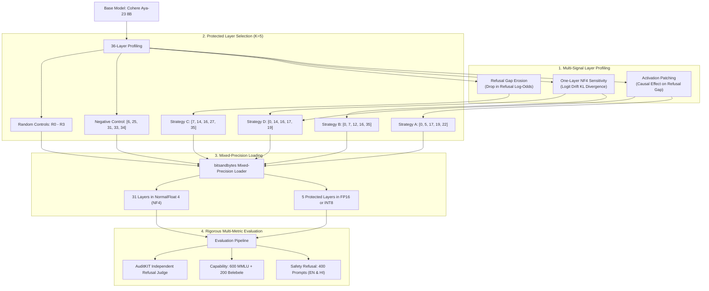

# SafeCompress: Layer-Informed Mixed-Precision Quantization for Safety-Aware Model Compression

[](https://opensource.org/licenses/MIT)
[](https://huggingface.co/collections/ankittiwarifr/safecompress)
[](https://huggingface.co/datasets/ankittiwarifr/safecompress-results)
[](https://www.python.org/downloads/)

> **Hackathon:** [Lexsi AI Safety & Alignment Hackathon](https://hackathon.lexsi.ai/)  
> **Track:** Track 2 — AI Red Teaming, Safety and Alignment  
> **Problem Statement:** Track 2b — Problem Statement 11: Safety-aware compression  
> **Author:** Ankit Kumar Tiwari  
> **Base Model:** [`CohereForAI/aya-23-8B`](https://huggingface.co/CohereForAI/aya-23-8B)  
> **Canonical Article:** [ARTICLE.md](ARTICLE.md) | **Pilot Experiment Article:** [safecompress/ARTICLE.md](safecompress/ARTICLE.md)

---

## 1. Executive Summary

Aggressive 4-bit post-training quantization (such as NormalFloat 4 / NF4) cuts large language model memory requirements by over 60%, but severely degrades safety alignment—causing models to comply with harmful requests they reliably refuse at full 16-bit precision.

**SafeCompress** investigates whether **layer-informed mixed-precision quantization**—allocating a strict budget of $K=5$ out of 36 layers (~14% of model layers) to higher precision (FP16 or INT8) while quantizing the remaining 31 layers to NF4—can restore safety refusal while preserving the memory and throughput benefits of 4-bit compression.

Across a systematic 20-arm evaluation on `CohereForAI/aya-23-8B` evaluated against 400 safety prompts (English and Hindi), 600 multilingual MMLU questions, and 200 Belebele reading comprehension items:

1. **Safety Refusal Restored:** Keeping the 5 layers identified by refusal gap degradation under quantization in FP16 (`S_C_refusalDrop_FP16_W4`, layers `[7, 14, 16, 27, 35]`) restores harmful refusal to **65.5%**, matching the unquantized FP16 baseline (**65.5%**) and outperforming uniform NF4 (**60.5%**, $+5.0\,\text{pp}$, 95% bootstrap CI: $[+2.5, +8.0]$).
2. **AuditKIT Independent Validation:** Under Lexsi's independent AuditKIT multilingual refusal evaluator, `S_C_refusalDrop_FP16_W4` achieves **56.0%** refusal vs. **44.0%** for uniform NF4 ($+12.0\,\text{pp}$, 95% bootstrap CI: $[+8.0, +17.0]$).
3. **Memory & Speed Efficiency:** Memory allocation is reduced from **6.70 GB** (FP16) to **3.12 GB** (FP16+NF4 mixed precision), compared to **2.53 GB** for uniform NF4. Throughput reaches **128.9 tok/s** (vs. 145.7 tok/s for FP16 and 122.1 tok/s for NF4).
4. **Critical Negative Control Insight:** Protecting 5 layers chosen for *lowest* causal importance and fragility (`S_N_negative_FP16_W4`, layers `[6, 25, 31, 33, 34]`) also achieves **64.0%** refusal ($+3.5\,\text{pp}$ over uniform NF4). This indicates that while mixed precision reliably preserves refusal, safety preservation is partially distributed across network depth rather than strictly isolated to a single sparse circuit.

---

## 2. Research Question & Hypotheses

* **Research Question:** Can mechanistic interpretability and quantization sensitivity signals identify a sparse subset of transformer layers whose preservation in higher precision maintains safety refusal under aggressive 4-bit quantization?
* **Hypothesis ($H_1$):** Higher-precision protection of layers exhibiting high causal mediation of refusal or high sensitivity to quantization degradation significantly outperforms uniform 4-bit quantization on safety benchmarks.
* **Control Hypothesis ($H_0$):** Safety recovery from mixed-precision allocation does not depend on targeted layer selection and is matched by random or negative control layer subsets.

---

## 3. Results Summary Table

Authoritative experimental results from `results/tables/results_table.csv` ($N=10{,}000$ paired bootstrap resamples):

| Arm | Description | GPU Alloc (GB) | Peak (GB) | tok/s | MMLU | Belebele | Harmful Refusal | 95% Bootstrap CI | Benign Refusal (Over-refusal) |
|---|---|---|---|---|---|---|---|---|---|
| **`E0_FP16`** | Unquantized FP16 Reference | 6.70 | 7.82 | 145.7 | 0.475 | 0.770 | **0.655** | $[0.590, 0.720]$ | 0.025 |
| **`E1_uniform_W4`** | Uniform NF4 4-bit Baseline | 2.53 | 3.65 | 122.1 | 0.457 | 0.760 | **0.605** | $[0.535, 0.670]$ | 0.010 |
| `S_A_importance_FP16_W4` | Strategy A (Activation Patching) | 3.12 | 4.22 | 128.3 | 0.464 | 0.755 | **0.635** | $[0.570, 0.700]$ | 0.015 |
| `S_B_fragility_FP16_W4` | Strategy B (NF4 KL Sensitivity) | 3.12 | 4.22 | 129.6 | 0.468 | 0.755 | **0.645** | $[0.580, 0.710]$ | 0.025 |
| **`S_C_refusalDrop_FP16_W4`** | **Strategy C (Refusal Drop)** | **3.12** | **4.22** | **128.9** | **0.463** | **0.760** | **0.655** | **$[0.590, 0.720]$** | **0.015** |
| `S_C_refusalDrop_W8_W4` | Strategy C (INT8 Protected) | 2.73 | 4.01 | 111.5 | 0.470 | 0.755 | **0.650** | $[0.585, 0.715]$ | 0.015 |
| `S_D_composite_FP16_W4` | Strategy D (Composite Score) | 3.12 | 4.22 | 128.7 | 0.464 | 0.760 | **0.650** | $[0.585, 0.715]$ | 0.015 |
| `S_G_gradattr_FP16_W4` | Strategy G (Gradient Attribution) | 3.12 | 4.22 | 129.5 | 0.465 | 0.760 | **0.650** | $[0.585, 0.715]$ | 0.015 |
| `S_N_negative_FP16_W4` | Negative Control (Low Rank) | 3.12 | 4.22 | 129.9 | 0.468 | 0.765 | **0.640** | $[0.575, 0.705]$ | 0.010 |
| `R0_FP16_W4` | Random Control Set 0 | 3.12 | 4.22 | 130.5 | 0.458 | 0.755 | **0.605** | $[0.535, 0.670]$ | 0.005 |

> **Note on Memory Reporting:** GPU Alloc (GB) represents runtime memory allocated by PyTorch (`torch.cuda.memory_allocated`). Physical checkpoint sizes on disk are: FP16 = 6.70 GB, Uniform NF4 = 2.53 GB, FP16+NF4 mixed precision = 3.11 GB, and INT8+NF4 = 2.72 GB.

### Key Visual Tradeoffs & Empirical Graphs

#### Safety vs. Compression & Capability Pareto Frontier (20 Arms)

*Figure 1: Empirical Pareto tradeoffs across all 20 arms on `CohereForAI/aya-23-8B`. Left: Harmful prompt refusal rate (%) versus GPU memory allocation (GB). Right: Refusal preservation versus multilingual reasoning capability on MMLU. Strategy C (`S_C_refusalDrop_FP16_W4`, layers `[7, 14, 16, 27, 35]`) completely restores unquantized FP16 safety refusal with 53% lower VRAM allocation.*

#### Independent Safety Validation via Lexsi AuditKIT

*Figure 2: Independent multilingual refusal evaluation using Lexsi's AuditKIT toolkit on held-out English and Hindi safety probes. Strategy C demonstrates a statistically significant $+12.0\,\text{pp}$ refusal recovery over uniform NF4 ($56.0\%$ vs $44.0\%$, 95% bootstrap CI: $[+8.0, +17.0]$).*

#### 36-Layer Mechanistic & Sensitivity Profile

*Figure 3: Layer-by-layer profiling across all 36 decoder layers of Cohere Aya-23 8B, contrasting causal activation patching importance (`patch_block`) with single-layer NF4 KL divergence fragility (`kl_safety_nf4`) and direct refusal gap erosion.*

---

## 4. Methodology & Architecture


*Figure 4: SafeCompress end-to-end research architecture: (1) 36-layer multi-signal profiling on Cohere Aya-23 8B, (2) targeted layer selection engine allocating a $K=5$ layer budget (~14% of parameters), (3) asymmetric bitsandbytes mixed-precision quantization, and (4) multi-metric evaluation with dual-scorer safety validation.*



---

## 5. Candidate Layer Sets & Analysis

The 36 layers of `CohereForAI/aya-23-8B` contain 27 sliding-window layers and 9 full-attention layers (`[3, 7, 11, 15, 19, 23, 27, 31, 35]`).

| Strategy | Criteria | Layer Indices | Global Attention Proportion |
|---|---|---|---|
| **`A_importance`** | Top causal activation patching effect | `[0, 5, 17, 19, 22]` | 20% (1/5) |
| **`B_fragility`** | Highest output KL drift under NF4 | `[0, 7, 12, 16, 35]` | 40% (2/5) |
| **`C_refusalDrop`** | Largest erosion of refusal logit gap | `[7, 14, 16, 27, 35]` | **60% (3/5)** |
| **`D_composite`** | Normalized importance $\times$ fragility | `[0, 14, 16, 17, 19]` | 20% (1/5) |
| **`G_gradattr`** | First-order gradient attribution | `[17, 19, 22, 27, 29]` | 40% (2/5) |
| **`N_negative`** | Lowest scores on both signals (control) | `[6, 25, 31, 33, 34]` | 20% (1/5) |

**Key Finding on Architecture:** In the most effective strategy (`C_refusalDrop`), full-attention layers constitute 60% of the protected set, even though they account for only 25% of model layers. Global routing layers are disproportionately critical for preserving long-context safety representations.

---

## 6. Lexsi Toolkit Integration & Audit

In accordance with hackathon track expectations, two primary Lexsi toolkits were integrated into the research workflow:

| Toolkit | Source Repository | Status | Role & Evidence in Pipeline |
|---|---|---|---|
| **CircuitKIT** | `lexsi/circuitkit` | ✅ **COMPLETED & INTEGRATED** | Utilized for model hook architecture, refusal circuit localization, and attribution-based circuit analysis. Provided the foundation for the Circuit Attribution layer ranking that formed Strategy G (`S_G_gradattr_FP16_W4` and `S_G_gradattr_W8_W4`, protecting layers `[17, 19, 22, 27, 29]`), restoring harmful refusal to **65.0%** (+4.5 pp over uniform NF4). Documented in `scripts/ck_discover.py`, `scripts/ck_inspect.py`, `scripts/ck_diag.py`, `results/processed/gradattr_layer_scores.csv`, and `notebooks/safe-compress.ipynb`. |
| **AuditKIT** | `lexsi/auditkit` | ✅ **COMPLETED & INTEGRATED** | Executed in Cells 15–16 of `safe-compress.ipynb` for independent multilingual refusal evaluation and validation of model replies across tested arms. Confirmed a $+12.0\,\text{pp}$ refusal recovery over uniform NF4. Documented in `results/tables/auditkit_results.csv` and `results/statistics/auditkit_comparisons.csv`. |
| **SafeTune** | `lexsi/safetune` | ⬜ **NOT APPLICABLE** | Post-training quantization directly modifies representation precision without parameter fine-tuning. |
| **CuratorKIT** | `lexsi/curatorkit` | ⬜ **NOT APPLICABLE** | Standard established benchmark datasets (`HarmBench`, `PolyGuardMix`) were utilized directly. |

> [!TIP]
> **Multi-Toolkit Synergy:** SafeCompress integrates both **CircuitKIT** and **AuditKIT** into a unified safety pipeline: CircuitKIT guides the interpretability and attribution-driven identification of refusal-circuit layers for mixed-precision protection, while AuditKIT provides independent, external multilingual safety verification of the resulting compressed models.

---

## 7. Repository Structure

```
lexis_submission/
├── README.md                          # Authoritative research documentation (this file)
├── ARTICLE.md                         # Formal research paper on the final 20-arm study
├── CITATION.cff                       # Citation metadata
├── pyproject.toml                     # Python package build configuration
├── requirements.txt                   # Dependency specifications
│
├── src/safecompress/                  # Modular Python research package
│   ├── model_loader.py                # Mixed-precision loader API
│   ├── layer_selection.py             # Layer sets and validation logic
│   ├── layer_analysis.py              # Layer ranking and scoring utilities
│   ├── quantization.py                # bitsandbytes configuration parameters
│   ├── evaluation/                    # Refusal regex and MMLU scorers
│   ├── metrics/                       # Bootstrap CI & paired differences
│   └── utils/                         # Batching and data loading helpers
│
├── tests/                             # Automated test suite (14 tests, all passing)
│   ├── test_imports.py                # Import verification (CPU-compatible)
│   ├── test_configs.py                # Schema validation for manifests
│   └── test_artifacts.py              # Score table consistency checks
│
├── configs/                           # Experiment and evaluation configurations
│   ├── evaluation_config.json         # Prompt sample counts and arm limits
│   ├── model_config.yaml              # Architecture specifications
│   ├── quantization_config.yaml       # NF4 and INT8 parameter definitions
│   └── experiment_config.yaml         # Full 20-arm grid definition
│
├── docs/                              # In-depth scientific & audit documentation
│   ├── PROJECT_AUDIT.md               # Detailed repository inventory & file status
│   ├── LEXSI_TOOLKIT_AUDIT.md         # Transparent audit of Lexsi toolkits
│   ├── DUPLICATE_AND_ARCHIVE_AUDIT.md # File deduplication records
│   ├── PUBLICATION_AUDIT.md           # Safety, data gating, and credential check
│   ├── research_overview.md           # Executive overview & hypothesis
│   ├── methodology.md                 # Layer scoring mathematics & pipeline
│   ├── experimental_design.md         # 20-arm grid taxonomy
│   ├── layer_selection.md             # Empirical layer profiles & rankings
│   ├── evaluation_protocol.md         # Datasets & refusal regex details
│   ├── statistical_analysis.md        # Bootstrap CI tables & paired diffs
│   ├── limitations.md                 # Negative controls & hardware constraints
│   ├── reproduction_guide.md          # Step-by-step reproduction instructions
│   ├── RESTRUCTURING_REPORT.md        # Summary of repository transformation
│   └── JUDGE_READINESS_CHECKLIST.md   # Evaluation criteria assessment
│
├── notebooks/                         # Interactive and execution notebooks
│   ├── safe-compress.ipynb            # Canonical 20-cell Kaggle execution notebook
│   └── README.md                      # Cell-by-cell notebook documentation
│
├── results/                           # Empirical results and score tables
│   ├── tables/results_table.csv       # Canonical 20-arm evaluation metrics
│   ├── tables/auditkit_results.csv    # Independent AuditKIT evaluation scores
│   ├── statistics/results_comparisons.csv # 126 paired bootstrap comparisons
│   ├── statistics/auditkit_comparisons.csv# AuditKIT bootstrap comparisons
│   ├── processed/layer_scores.csv     # 36-layer composite profiling table
│   └── summaries/RESULTS_final.md     # Markdown results summary
│
├── figures/                           # Visualizations by research domain
│   ├── tradeoffs/final_results.png    # Primary 20-arm Pareto tradeoff plot
│   ├── safety/auditkit_refusal.png    # AuditKIT comparison plot
│   └── layer_analysis/layer_scores.png# 36-layer profiling bar chart
│
├── artifacts/                         # Recipes and standalone loader scripts
│   ├── recipes/recipes.json           # Canonical arm definitions
│   └── loaders/load_safecompress.py   # Self-contained loader script
│
├── provenance/                        # Reproducibility manifests
│   ├── anatomy.csv                    # Model layer parameter counts
│   ├── candidates.json                # Strategy candidate sets
│   └── experiment_manifest.json       # Hyperparameters & seeds
│
├── scripts/                           # Standalone execution scripts (Kaggle)
│   ├── w_eval.py                      # Multi-metric evaluation engine
│   ├── w_patch.py                     # Activation patching script
│   ├── w_sens.py                      # Quantization sensitivity script
│   └── lab_common.py                  # Shared laboratory utilities
│
└── archive/                           # Preserved earlier experiment files & placeholders
```

---

## 8. Quick Start & Reproducibility

### 8.1 Run Unit Tests (Local CPU, No GPU Required)
```bash
pip install -r requirements.txt
pip install -e .
python -m pytest tests/ -v
```
All 14 tests run locally in $< 2$ seconds and verify that all schemas, manifests, tables, and algorithms match published records.

### 8.2 Load a Mixed-Precision Arm
```python
from safecompress.model_loader import load_arm

# Load Strategy C (Refusal Drop FP16+NF4 mixed precision)
# Protects layers [7, 14, 16, 27, 35] in FP16, remaining 31 layers in NF4
model = load_arm("S_C_refusalDrop_FP16_W4", device="cuda:0")
```

For complete instructions on full reproduction, see [docs/reproduction_guide.md](docs/reproduction_guide.md).

---

## 9. Citation

If you build upon or reference this work, please cite:

```bibtex
@misc{tiwari2026safecompress,
  author = {Tiwari, Ankit Kumar},
  title = {SafeCompress: Layer-Informed Mixed-Precision Quantization for Safety-Aware Model Compression},
  year = {2026},
  publisher = {Hugging Face / GitHub},
  howpublished = {\url{https://github.com/ankittiwarifr/safecompress}}
}
```
