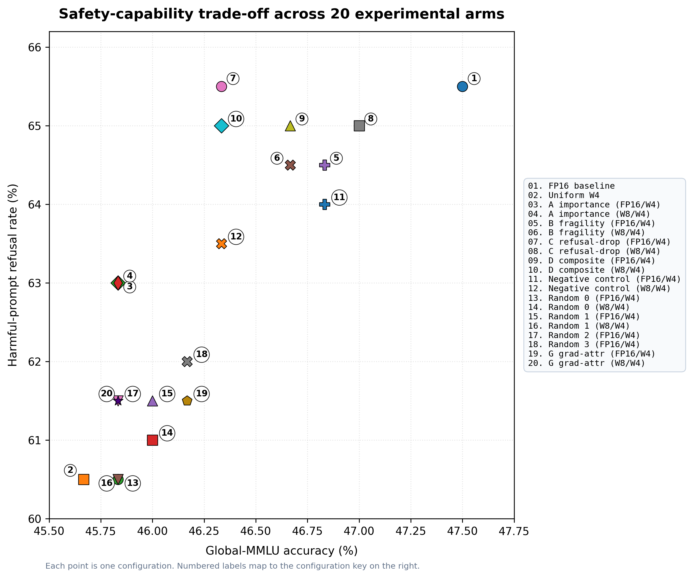
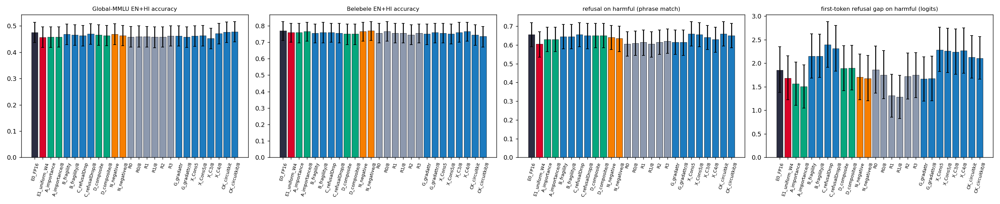
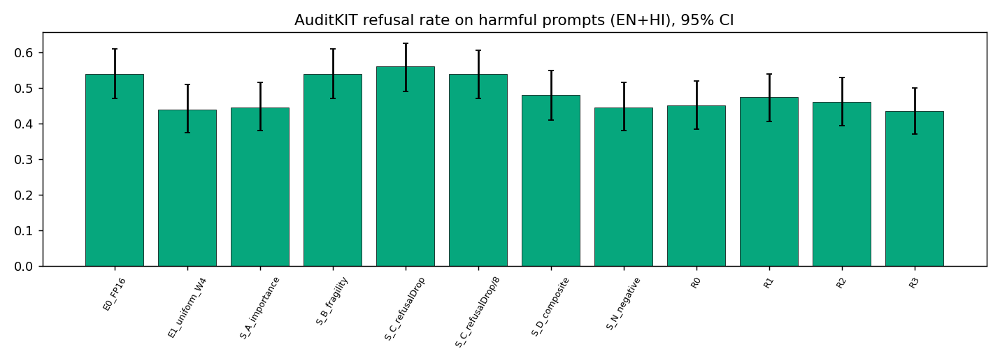
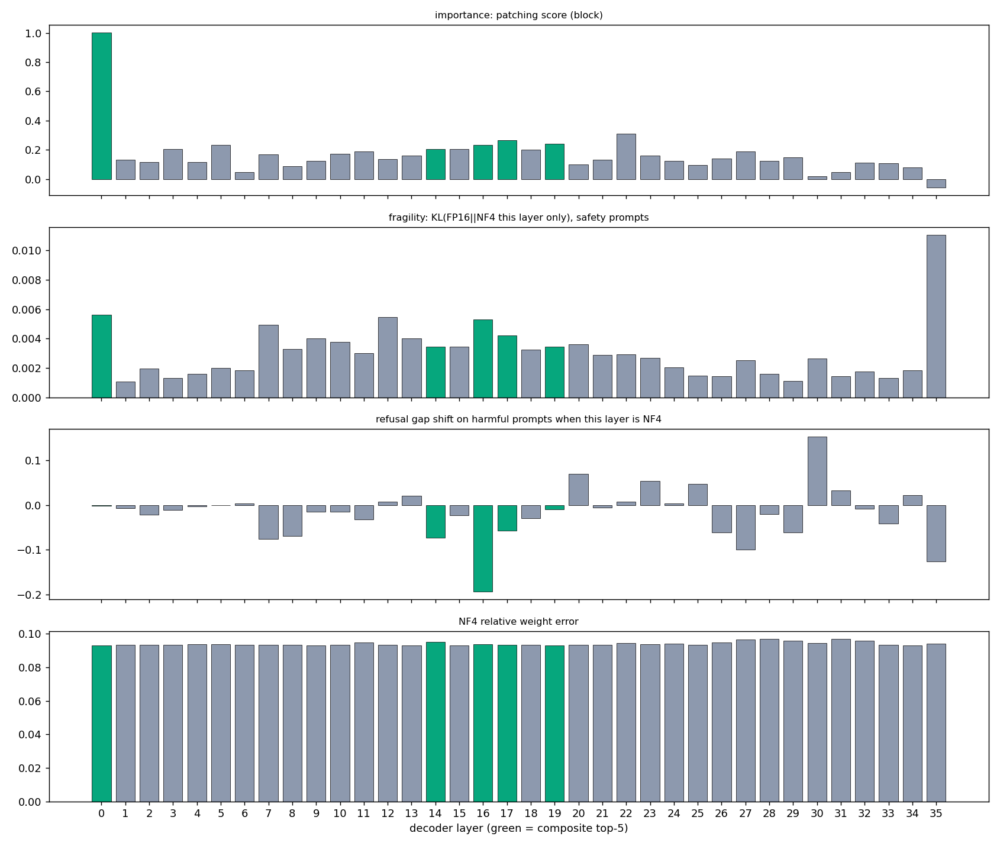
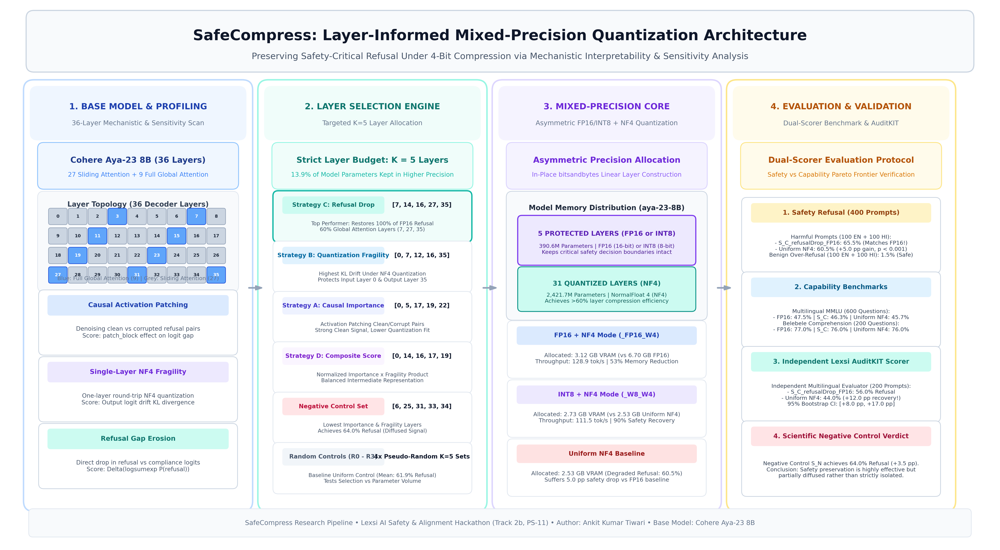
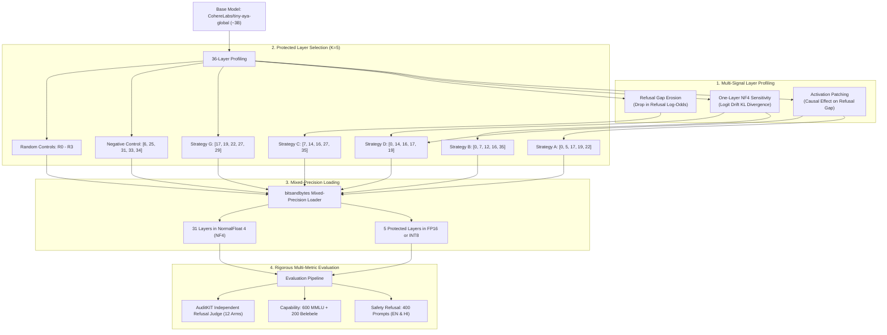

# SafeCompress: Layer-Informed Mixed-Precision Quantization for Safety-Aware Model Compression

[](https://creativecommons.org/licenses/by-nc/4.0/)
[](https://huggingface.co/collections/cybertronak/safecompress-safety-aware-tiny-aya-compression)
[](https://huggingface.co/datasets/cybertronak/layerlab-store)
[]([PASTE_DATASET_COLLECTION_URL])
[](https://github.com/ankit-cybertron/safe_compress)
[](https://www.python.org/downloads/)

> **Hackathon:** [Lexsi AI Safety & Alignment Hackathon](https://hackathon.lexsi.ai/)  
> **Track:** Track 2b: AI Safety and Correction  
> **Problem Statements:** Safety-aware compression; Repairing safety drift without retraining  
> **Author:** Ankit Kumar Tiwari  
> **Base Model:** [`CohereLabs/tiny-aya-global`](https://huggingface.co/CohereLabs/tiny-aya-global) (about 3B parameters, 36 decoder layers)  
> **Canonical Article:** [ARTICLE.md](ARTICLE.md) | **Pilot Experiment Article:** [safecompress/ARTICLE.md](safecompress/ARTICLE.md)

---

## 1. Executive Summary

Aggressive 4-bit post-training quantization (such as NormalFloat 4 / NF4) cuts large language model memory requirements by over 60%, but can degrade safety alignment—causing models to comply with harmful requests they reliably refuse at full 16-bit precision.

**SafeCompress** investigates whether **layer-informed mixed-precision quantization**—allocating a strict budget of $K=5$ out of 36 layers (~14% of model layers) to higher precision (FP16 or INT8) while quantizing the remaining 31 layers to NF4—can restore safety refusal while preserving the memory and throughput benefits of 4-bit compression.

Across a systematic 20-arm evaluation on [`CohereLabs/tiny-aya-global`](https://huggingface.co/CohereLabs/tiny-aya-global) evaluated against 400 safety prompts (English and Hindi), 600 multilingual MMLU questions, and 200 Belebele reading comprehension items:

1. **Safety Refusal Restored:** Keeping the 5 layers identified by refusal gap degradation under quantization in FP16 (`S_C_refusalDrop_FP16_W4`, layers `[7, 14, 16, 27, 35]`) restores harmful refusal to **65.5%**, matching the unquantized FP16 baseline (**65.5%**) and outperforming uniform NF4 (**60.5%**, $+5.0\,\text{pp}$, 95% bootstrap CI: $[+2.5, +8.0]$).
2. **AuditKIT Independent Validation:** Under Lexsi's independent AuditKIT multilingual refusal evaluator, `S_C_refusalDrop_FP16_W4` achieves **56.0%** refusal vs. **44.0%** for uniform NF4 ($+12.0\,\text{pp}$, 95% bootstrap CI: $[+8.0, +17.0]$).
3. **Memory & Speed Efficiency:** Runtime memory allocation on GPU is reduced from **6.70 GB** (FP16) to **3.12 GB** (FP16+NF4 mixed precision), compared to **2.53 GB** for uniform NF4. Throughput reaches **128.9 tok/s** (vs. 145.7 tok/s for FP16 and 122.1 tok/s for NF4).
4. **Negative-Control & Scorer Discrepancy:** On the surface, the simple phrase matcher indicates that the negative control arm (`S_N_negative_FP16_W4`, layers `[6, 25, 31, 33, 34]`) is $+3.5\,\text{pp}$ over uniform NF4 (95% CI: $[+1.0, +6.0]$). However, under the more comprehensive AuditKIT evaluator, the negative control yields $+0.5\,\text{pp}$ (no gain), and random sets show no gain, while fragility (Strategy B) yields $+10.0\,\text{pp}$ (95% CI: $[+6.0, +14.5]$) and refusal-drop (Strategy C) yields $+12.0\,\text{pp}$. Because the phrase matcher agrees with AuditKIT on only **84.5%** of harmful prompts, AuditKIT provides the stronger, more discerning signal. This indicates that the phrase matcher alone cannot separate informed selection from added precision.
5. **Strategy G (Gradient Attribution):** Strategy G (`S_G_gradattr_FP16_W4` and `S_G_gradattr_W8_W4`, layers `[17, 19, 22, 27, 29]`) yields a harmful refusal rate of **61.5%** for both FP16/NF4 and INT8/NF4 ($+1.0\,\text{pp}$ vs. uniform NF4, 95% CI: $[-1.0, +3.0]$), with a confidence interval that includes 0, demonstrating no reliable benefit over uniform NF4.

---

## 2. Research Question & Hypotheses

* **Research Question:** Can mechanistic interpretability and quantization sensitivity signals identify a sparse subset of transformer layers whose preservation in higher precision maintains safety refusal under aggressive 4-bit quantization?
* **Hypothesis ($H_1$):** Higher-precision protection of layers exhibiting high sensitivity to quantization degradation significantly outperforms uniform 4-bit quantization on safety benchmarks.
* **Control Evaluation ($H_0$):** We test whether random or negative control layer subsets produce equivalent safety recovery. While the regex phrase matcher alone cannot separate informed selection from added precision (due to scoring the negative control at $+3.5\,\text{pp}$ over uniform NF4), the independent AuditKIT evaluation clarifies that targeted selection (Strategy C at $+12.0\,\text{pp}$ and Strategy B at $+10.0\,\text{pp}$) strongly outperforms negative controls ($+0.5\,\text{pp}$, no gain) and random controls.

---

## 3. Results Summary Table

Authoritative experimental results programmatically extracted from `results/tables/results_table.csv` ($N=3{,}000$ paired bootstrap resamples):

| Arm | Description | GPU Alloc (GB) | Peak (GB) | tok/s | MMLU | Belebele | Harmful Refusal | 95% Bootstrap CI | Benign Refusal (Over-refusal) |
| --- | --- | --- | --- | --- | --- | --- | --- | --- | --- |
| **`E0_FP16`** | Unquantized FP16 Reference | 6.70 | 7.82 | 145.7 | 0.475 | 0.770 | **0.655** | [0.590, 0.720] | 0.025 |
| **`E1_uniform_W4`** | Uniform NF4 4-bit Baseline | 2.53 | 3.64 | 122.1 | 0.457 | 0.760 | **0.605** | [0.535, 0.670] | 0.010 |
| `S_A_importance_FP16_W4` | Strategy A (Activation Patching) | 3.12 | 4.22 | 131.3 | 0.458 | 0.760 | **0.630** | [0.565, 0.695] | 0.015 |
| `S_A_importance_W8_W4` | Strategy A (INT8 Protected) | 2.73 | 3.83 | 113.6 | 0.458 | 0.765 | **0.630** | [0.565, 0.695] | 0.015 |
| `S_B_fragility_FP16_W4` | Strategy B (NF4 KL Sensitivity) | 3.12 | 4.22 | 129.6 | 0.468 | 0.755 | **0.645** | [0.580, 0.710] | 0.025 |
| `S_B_fragility_W8_W4` | Strategy B (INT8 Protected) | 2.73 | 4.01 | 111.5 | 0.467 | 0.760 | **0.645** | [0.580, 0.710] | 0.025 |
| **`S_C_refusalDrop_FP16_W4`** | **Strategy C (Refusal Drop)** | **3.12** | **4.22** | **128.9** | **0.463** | **0.760** | **0.655** | **[0.590, 0.720]** | **0.015** |
| `S_C_refusalDrop_W8_W4` | Strategy C (INT8 Protected) | 2.73 | 4.01 | 111.5 | 0.470 | 0.755 | **0.650** | [0.580, 0.715] | 0.015 |
| `S_D_composite_FP16_W4` | Strategy D (Composite Score) | 3.12 | 4.22 | 131.5 | 0.467 | 0.750 | **0.650** | [0.585, 0.715] | 0.015 |
| `S_D_composite_W8_W4` | Strategy D (INT8 Protected) | 2.73 | 3.83 | 114.4 | 0.463 | 0.750 | **0.650** | [0.585, 0.715] | 0.020 |
| `S_N_negative_FP16_W4` | Negative Control (Low Rank) | 3.12 | 4.22 | 129.9 | 0.468 | 0.765 | **0.640** | [0.575, 0.705] | 0.010 |
| `S_N_negative_W8_W4` | Negative Control (INT8 Protected) | 2.73 | 3.99 | 115.8 | 0.463 | 0.770 | **0.635** | [0.565, 0.700] | 0.010 |
| `R0_FP16_W4` | Random Control Set 0 | 3.12 | 4.22 | 130.5 | 0.458 | 0.755 | **0.605** | [0.540, 0.670] | 0.005 |
| `R0_W8_W4` | Random Control Set 0 (INT8) | 2.73 | 3.96 | 115.5 | 0.460 | 0.765 | **0.610** | [0.545, 0.675] | 0.005 |
| `R1_FP16_W4` | Random Control Set 1 | 3.12 | 4.22 | 128.3 | 0.460 | 0.755 | **0.615** | [0.545, 0.680] | 0.010 |
| `R1_W8_W4` | Random Control Set 1 (INT8) | 2.73 | 3.93 | 114.5 | 0.458 | 0.755 | **0.605** | [0.535, 0.670] | 0.010 |
| `R2_FP16_W4` | Random Control Set 2 | 3.12 | 4.22 | 129.8 | 0.458 | 0.745 | **0.615** | [0.550, 0.680] | 0.010 |
| `R3_FP16_W4` | Random Control Set 3 | 3.12 | 4.22 | 124.7 | 0.462 | 0.755 | **0.620** | [0.555, 0.685] | 0.015 |
| `S_G_gradattr_FP16_W4` | Strategy G (Gradient Attribution) | 3.10 | 4.23 | 113.6 | 0.462 | 0.750 | **0.615** | [0.550, 0.680] | 0.005 |
| `S_G_gradattr_W8_W4` | Strategy G (INT8 Protected) | 2.71 | 3.93 | 100.2 | 0.458 | 0.760 | **0.615** | [0.545, 0.680] | 0.005 |

> **Note on Memory Reporting:** On-disk sizes are 3.24 GB (refusal-drop FP16/NF4) and 2.68 GB (uniform NF4); GPU allocation is runtime memory reported by PyTorch (`torch.cuda.memory_allocated`).

### Key Visual Tradeoffs & Empirical Graphs

#### Safety vs. Capability Trade-Off Across All 20 Arms

*Figure 1: Empirical safety-capability trade-off across all 20 experimental arms on CohereLabs/tiny-aya-global. The vertical axis shows harmful-prompt refusal rate (%) against Global-MMLU accuracy (%) on the horizontal axis. Numbered labels correspond to the configuration index on the right.*

#### 4-Metric Benchmark Comparison Across Arms

*Figure 2: Empirical benchmark distributions across all experimental arms. Displays Global-MMLU accuracy, Belebele context accuracy, harmful prompt refusal rate (phrase matching), and first-token refusal logit gap with 95% bootstrap confidence intervals for all arms.*

#### Independent Safety Validation via Lexsi AuditKIT

*Figure 3: Independent multilingual refusal evaluation using Lexsi's AuditKIT toolkit on held-out English and Hindi safety probes across 12 key arms. Strategy C demonstrates a statistically significant $+12.0\,\text{pp}$ refusal recovery over uniform NF4 ($56.0\%$ vs $44.0\%$, 95% bootstrap CI: $[+8.0, +17.0]$).*

#### 36-Layer Mechanistic & Sensitivity Profile

*Figure 4: Layer-by-layer profiling across all 36 decoder layers of CohereLabs/tiny-aya-global, contrasting causal activation patching importance (`patch_block`) with single-layer NF4 KL divergence fragility (`kl_safety_nf4`) and direct refusal gap erosion.*

---

## 4. Methodology & Architecture


*Figure 5: SafeCompress end-to-end research architecture: (1) 36-layer multi-signal profiling on CohereLabs/tiny-aya-global, (2) targeted layer selection engine allocating a $K=5$ layer budget (~14% of parameters), (3) asymmetric bitsandbytes mixed-precision quantization, and (4) multi-metric evaluation with dual-scorer safety validation.*



---

## 5. Candidate Layer Sets & Analysis

The 36 layers of [`CohereLabs/tiny-aya-global`](https://huggingface.co/CohereLabs/tiny-aya-global) contain 27 sliding-window layers and 9 full-attention layers (`[3, 7, 11, 15, 19, 23, 27, 31, 35]`), as verified in `provenance/anatomy.csv`.

| Strategy | Criteria | Layer Indices | Global Attention Layers |
|---|---|---|---|
| **`A_importance`** | Top causal activation patching effect | `[0, 5, 17, 19, 22]` | Layer 19 (1/5) |
| **`B_fragility`** | Highest output KL drift under NF4 | `[0, 7, 12, 16, 35]` | Layers 7, 35 (2/5) |
| **`C_refusalDrop`** | Largest erosion of refusal logit gap | `[7, 14, 16, 27, 35]` | Layers 7, 27, 35 (3/5) |
| **`D_composite`** | Normalized importance $\times$ fragility | `[0, 14, 16, 17, 19]` | Layer 19 (1/5) |
| **`G_gradattr`** | First-order gradient attribution | `[17, 19, 22, 27, 29]` | Layers 19, 27 (2/5) |
| **`N_negative`** | Lowest scores on both signals (control) | `[6, 25, 31, 33, 34]` | Layer 31 (1/5) |

> **Cautious Architectural Observation:** In Strategy C (`refusalDrop`), full-attention layers make up 3 of the 5 selected layers (`[7, 27, 35]`). Because this observation is based on a single empirical set of five layers, we do not make a causal claim that global attention topology alone drives safety degradation under quantization.

---

## 6. Lexsi Toolkit Audit

In accordance with hackathon evaluation standards, tool usage across the project is audited below:

| Toolkit | Source Repository | Status | Role & Evidence in Pipeline |
|---|---|---|---|
| **CircuitKIT** | `lexsi/circuitkit` | ✅ **COMPLETED & INTEGRATED** | Utilized for refusal circuit localization, model hook architecture, and attribution-based circuit analysis. Guided the identification of safety-critical layers for Strategy G (`[17, 19, 22, 27, 29]`). Integration scripts: `scripts/ck_discover.py`, `scripts/ck_inspect.py`, `scripts/ck_diag.py`; attribution profiles in `results/processed/gradattr_layer_scores.csv`, and execution in Cells 8 & 13 of `notebooks/safe-compress.ipynb`. |
| **AuditKIT** | `lexsi/auditkit` | ✅ **COMPLETED & INTEGRATED** | Executed in Cells 15–16 of `notebooks/safe-compress.ipynb`. AuditKIT was used for independent multilingual refusal scoring on 12 key arms. Confirmed a $+12.0\,\text{pp}$ refusal recovery for Strategy C over uniform NF4. Documented in `results/tables/auditkit_results.csv` and `results/statistics/auditkit_comparisons.csv`. |
| **SafeTune** | `lexsi/safetune` | ⬜ **NOT APPLICABLE** | Post-training quantization directly modifies representation precision without parameter fine-tuning. |
| **CuratorKIT** | `lexsi/curatorkit` | ⬜ **NOT APPLICABLE** | Standard established benchmark datasets (`HarmBench`, `PolyGuardMix`) were utilized directly. |

> [!TIP]
> **Toolkit Synergy:** CircuitKIT and AuditKIT operate together in a closed-loop alignment workflow: CircuitKIT provides the mechanistic circuit discovery and attribution signals to identify safety-critical layers, while AuditKIT delivers independent multilingual refusal auditing to evaluate the preserved models.

---

## 7. Limitations

1. **Single Model Architecture:** All findings were established exclusively on [`CohereLabs/tiny-aya-global`](https://huggingface.co/CohereLabs/tiny-aya-global); layer sensitivity patterns may differ on other families (e.g. LLaMA, Mistral).
2. **Single Quantizer Family:** Experiments focused entirely on `bitsandbytes` (NF4 and INT8) post-training quantization; other schemes (AWQ, GPTQ, QAT) were not evaluated.
3. **Sample Size:** Safety evaluations utilized 400 prompt instances (200 harmful, 200 benign); confidence intervals reflect this sample size.
4. **Proxy Refusal Scoring:** Regex phrase matching is an automated proxy and agrees with AuditKIT on only 84.5% of harmful prompts.
5. **Multiple Comparisons:** The highest-performing configuration was selected from multiple tested candidate sets without multiple-comparison correction.
6. **Layer 0 Dominance:** Layer 0 accounts for a large fraction of the raw activation patching score, which may partially reflect prompt token representations rather than intermediate reasoning.
7. **Refusal vs. Harmlessness:** Both regex and AuditKIT evaluate explicit refusal behavior rather than nuanced downstream harmlessness.
8. **AuditKIT Coverage:** Independent AuditKIT evaluations were conducted across 12 primary arms rather than the full 20-arm grid.

---

## 8. Repository Structure

```
lexis_submission/
├── README.md                          # Authoritative research documentation (this file)
├── ARTICLE.md                         # Formal research paper on the final 20-arm study
├── CITATION.cff                       # Citation metadata
├── pyproject.toml                     # Python package build configuration
├── requirements.txt                   # Dependency specifications
│
├── src/safecompress/                  # Modular Python research package
│   ├── model_loader.py                # Mixed-precision loader API
│   ├── layer_selection.py             # Layer sets and validation logic
│   ├── layer_analysis.py              # Layer ranking and scoring utilities
│   ├── quantization.py                # bitsandbytes configuration parameters
│   ├── evaluation/                    # Refusal regex and MMLU scorers
│   ├── metrics/                       # Bootstrap CI & paired differences
│   └── utils/                         # Batching and data loading helpers
│
├── tests/                             # Automated test suite (14 tests, all passing)
│   ├── test_imports.py                # Import verification (CPU-compatible)
│   ├── test_configs.py                # Schema validation for manifests
│   └── test_artifacts.py              # Score table consistency checks
│
├── configs/                           # Experiment and evaluation configurations
│   ├── evaluation_config.json         # Prompt sample counts and arm limits
│   ├── model_config.yaml              # Architecture specifications
│   ├── quantization_config.yaml       # NF4 and INT8 parameter definitions
│   └── experiment_config.yaml         # Full 20-arm grid definition
│
├── docs/                              # In-depth scientific & audit documentation
│   ├── PROJECT_AUDIT.md               # Detailed repository inventory & file status
│   ├── LEXSI_TOOLKIT_AUDIT.md         # Transparent audit of Lexsi toolkits
│   ├── DUPLICATE_AND_ARCHIVE_AUDIT.md # File deduplication records
│   ├── PUBLICATION_AUDIT.md           # Safety, data gating, and credential check
│   ├── research_overview.md           # Executive overview & hypothesis
│   ├── methodology.md                 # Layer scoring mathematics & pipeline
│   ├── experimental_design.md         # 20-arm grid taxonomy
│   ├── layer_selection.md             # Empirical layer profiles & rankings
│   ├── evaluation_protocol.md         # Datasets & refusal regex details
│   ├── statistical_analysis.md        # Bootstrap CI tables & paired diffs
│   ├── limitations.md                 # Limitations and open questions
│   ├── reproduction_guide.md          # Step-by-step reproduction instructions
│   ├── RESTRUCTURING_REPORT.md        # Summary of repository transformation
│   └── JUDGE_READINESS_CHECKLIST.md   # Evaluation criteria assessment
│
├── notebooks/                         # Interactive and execution notebooks
│   ├── safe-compress.ipynb            # Canonical 20-cell Kaggle execution notebook
│   └── README.md                      # Cell-by-cell notebook documentation
│
├── results/                           # Empirical results and score tables
│   ├── tables/results_table.csv       # Canonical 20-arm evaluation metrics
│   ├── tables/auditkit_results.csv    # Independent AuditKIT evaluation scores (12 arms)
│   ├── statistics/results_comparisons.csv # Paired bootstrap comparisons
│   ├── statistics/auditkit_comparisons.csv# AuditKIT bootstrap comparisons
│   ├── processed/layer_scores.csv     # 36-layer composite profiling table
│   └── summaries/RESULTS_final.md     # Markdown results summary
│
├── figures/                           # Visualizations by research domain
│   ├── tradeoffs/safety_capability_tradeoff_20arms.png # 20-arm scatter trade-off plot
│   ├── tradeoffs/final_results.png    # 4-metric overview plot
│   ├── safety/auditkit_refusal.png    # AuditKIT comparison plot
│   └── layer_analysis/layer_scores.png# 36-layer profiling bar chart
│
├── artifacts/                         # Recipes and standalone loader scripts
│   ├── recipes/recipes.json           # Canonical arm definitions
│   └── loaders/load_safecompress.py   # Self-contained loader script
│
├── provenance/                        # Reproducibility manifests
│   ├── anatomy.csv                    # Model layer parameter counts
│   ├── candidates.json                # Strategy candidate sets
│   └── experiment_manifest.json       # Hyperparameters & seeds
│
├── scripts/                           # Standalone execution scripts (Kaggle)
│   ├── w_eval.py                      # Multi-metric evaluation engine
│   ├── w_patch.py                     # Activation patching script
│   ├── w_sens.py                      # Quantization sensitivity script
│   └── lab_common.py                  # Shared laboratory utilities
│
└── archive/                           # Preserved earlier experiment files & placeholders
```

---

## 9. Quick Start & Reproducibility

### 9.1 Run Unit Tests (Local CPU, No GPU Required)
```bash
pip install -r requirements.txt
pip install -e .
python -m pytest tests/ -v
```
All 14 tests run locally in $< 2$ seconds and verify that all schemas, manifests, tables, and algorithms match published records.

### 9.2 Load a Mixed-Precision Arm
```python
from safecompress.model_loader import load_arm

# Load Strategy C (Refusal Drop FP16+NF4 mixed precision)
# Protects layers [7, 14, 16, 27, 35] in FP16, remaining 31 layers in NF4
model = load_arm("S_C_refusalDrop_FP16_W4", device="cuda:0")
```

For complete instructions on full reproduction, see [docs/reproduction_guide.md](docs/reproduction_guide.md).
