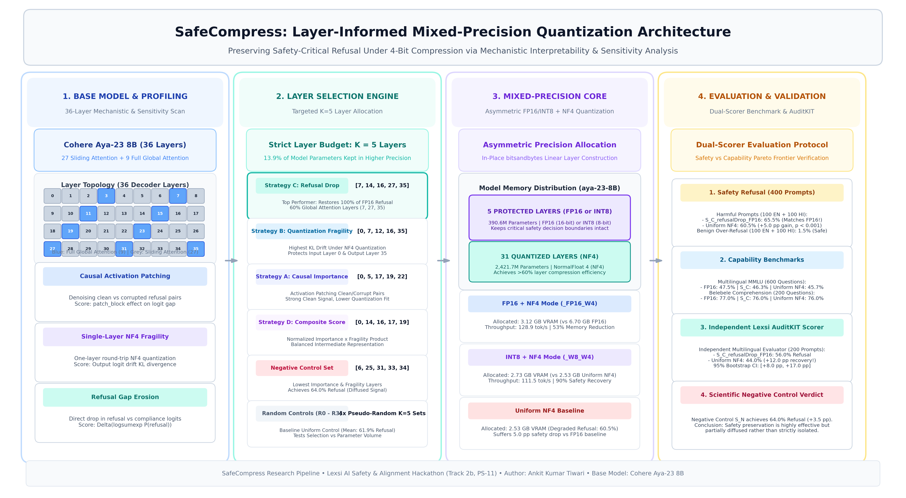
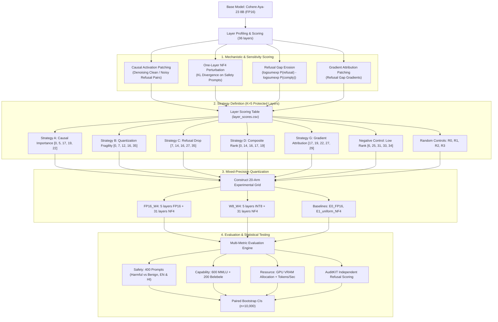

# Methodology — SafeCompress

SafeCompress combines mechanistic interpretability techniques with post-training quantization sensitivity analysis to guide layer allocation under a strict parameter budget.

---

## 1. High-Level Pipeline

*Figure 1: SafeCompress four-stage research architecture: 36-layer multi-signal profiling, layer selection engine, asymmetric bitsandbytes mixed-precision quantization, and dual-scorer validation.*

---

## 2. Layer Scoring Techniques

### Method 1: Causal Activation Patching (`scripts/w_patch.py`)
To isolate which layers actively mediate the transition between harmful refusal and compliant responses:
1. Balanced pairs of harmful prompts and benign compliance prompts were drawn from PolyGuardMix in English and Hindi ($N=96$ pairs per language, max length 160 tokens).
2. For each layer $l \in [0, 35]$, activations of the clean compliant run were patched into the corrupted harmful run (and vice versa) at the residual stream block output.
3. The causal effect is measured by the change in the model's refusal logit gap:
$$\Delta \text{Gap}_l = \text{Gap}(\text{patched}_l) - \text{Gap}(\text{baseline})$$
The resulting metric `patch_block` quantifies how strongly layer $l$'s intermediate representation controls the refusal decision.

### Method 2: Quantization Sensitivity & Fragility (`scripts/w_sens.py`)
Rather than relying solely on unquantized activations, we measure how each layer responds to actual quantization perturbation:
1. A single layer $l$ is fake-quantized in-place to NF4 (or INT8) while all other 35 layers remain at FP16.
2. The model evaluates a validation set of safety and benign prompts.
3. Two signals are recorded:
   - **Output KL Divergence (`kl_safety_nf4`):** Measures distribution drift over output logits caused by quantizing layer $l$:
     $$D_{\text{KL}}(P_{\text{FP16}} \parallel P_{\text{NF4}, l})$$
   - **Refusal Gap Erosion (`gap_drop_nf4`):** The drop in relative refusal log-odds:
     $$\text{Drop}_l = \text{Gap}_{\text{FP16}} - \text{Gap}_{\text{NF4}, l}$$

### Method 3: First-Order Gradient Attribution (`scripts/w_attr.py`)
To validate patching without full activation caching:
1. Gradients of the refusal gap with respect to each layer's attention and MLP outputs are accumulated via a single backward pass:
   $$\text{Attr}_l = \left| \nabla_{h_l} \text{Gap} \cdot h_l \right|$$
2. Provides a gradient-based importance signal captured in `gradattr_layer_scores.csv`.

---

## 3. Mixed-Precision Execution (`artifacts/loaders/load_safecompress.py`)

Quantization is performed dynamically at load time via `bitsandbytes`:
- **Unquantized Layers:** Maintained as `torch.float16` (`pbits=16`).
- **INT8 Protected Layers:** Converted to `bitsandbytes.nn.Linear8bitLt` with outlier threshold 6.0 (`pbits=8`).
- **Quantized Layers:** Converted to `bitsandbytes.nn.Linear4bit` using NormalFloat 4 (`rbits=4`), blocksize 64, compute dtype `torch.float16`, without double quantization.
- Parameter allocation: Each layer contains 78.12M parameters (10.49M attention + 67.63M MLP). Protecting 5 layers keeps 390.6M parameters in higher precision while 2,421.7M layer parameters are in 4-bit.
