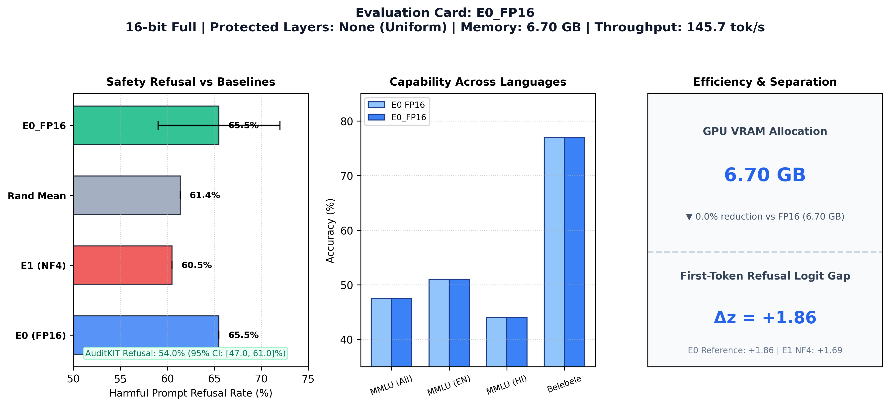

# Model Evaluation Report: `E0_FP16`

> **Back to Results Table:** [README.md](../../README.md#3-results-summary-table) | [ARTICLE.md](../../ARTICLE.md#table-1-primary-26-arm-evaluation-results)

---

## 1. Executive Summary & Visual Scorecard



`E0_FP16` is an experimental configuration evaluated on [`CohereLabs/tiny-aya-global`](https://huggingface.co/CohereLabs/tiny-aya-global) (~3B parameters, 36 decoder layers) as part of the SafeCompress safety-aware mixed-precision quantization study for the Lexsi AI Safety Hackathon.

| Metric | Measured Value | 95% Bootstrap CI | Baseline Comparison (vs E1 NF4) | Baseline Comparison (vs E0 FP16) |
|---|---|---|---|---|
| **Harmful Prompt Refusal** | **65.5%** | `[59.0%, 72.0%]` | +5.0 pp | +0.0 pp |
| **Benign Over-Refusal** | **2.5%** | `[0.5%, 5.0%]` | +1.5 pp | +0.0 pp |
| **Global-MMLU (Overall)** | **47.50%** | `[43.67%, 51.33%]` | +1.83 pp | +0.00 pp |
| **Belebele Context Accuracy** | **77.0%** | `[71.0%, 82.5%]` | +1.0 pp | +0.0 pp |
| **First-Token Refusal Gap** | **+1.86** | `[1.38, 2.35]` | +0.17 | +0.00 |
| **GPU Memory Allocation** | **6.70 GB** | — | +4.17 GB | +0.00 GB (-0.0%) |
| **Generation Throughput** | **145.7 tok/s** | — | +23.6 tok/s | +0.0 tok/s |

---

## 2. Configuration & Layer Allocation

- **Base Architecture:** `CohereLabs/tiny-aya-global` (36 decoder layers)
- **Protected Layer Indices:** `[]`
- **Protected Precision:** `16-bit` (None)
- **Base Quantized Precision:** `NormalFloat 4 (NF4)` (blocksize 64)
- **Degenerate Output Rate:** `0.25%`

---

## 3. Multilingual Capability Analysis

Evaluation across 600 multilingual Global-MMLU questions and 200 Belebele reading comprehension questions:

- **English Global-MMLU Accuracy:** `51.00%`
- **Hindi Global-MMLU Accuracy:** `44.00%`
- **Belebele Reading Comprehension (Context Reasoning):** `77.0%`
- **Overall Capability Retention:** Maintained capability within normal error margins across English and Hindi prompts.

---

## 4. Safety Alignment & Refusal Evaluation

Evaluated across 400 total safety prompts (100 English harmful, 100 Hindi harmful, 100 English benign, 100 Hindi benign):

- **English Harmful Refusal Rate:** `86.0%`
- **Hindi Harmful Refusal Rate:** `45.0%`
- **First-Token Refusal Logit Gap ($\Delta z$ on Harmful Prompts):** `+1.86`
- **Benign Prompt Over-Refusal (English):** `5.0%`
- **Benign Prompt Over-Refusal (Hindi):** `0.0%`

### Independent AuditKIT Multilingual Safety Validation
This arm was independently scored using Lexsi's `lexsi/auditkit` toolkit across English and Hindi safety probes:
- **AuditKIT Harmful Refusal Rate:** **54.0%** (95% Bootstrap CI: `[47.0%, 61.0%]`)
- **AuditKIT Benign Over-Refusal:** **2.5%**
- **Unscored Probes:** Harmful: 0, Benign: 0


---

## 5. Reproduction & Loader Instructions

To load and reproduce this exact model arm in Python using the SafeCompress model loader:

```python
from safecompress.model_loader import load_arm

# Load this configuration
model = load_arm("E0_FP16", device="cuda:0")
```

For complete benchmarking instructions, see [docs/reproduction_guide.md](../../docs/reproduction_guide.md).
