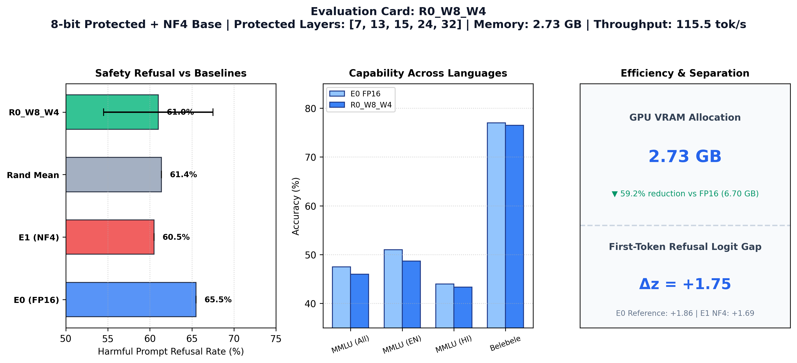

# Model Evaluation Report: `R0_W8_W4`

> **Back to Results Table:** [README.md](../../README.md#3-results-summary-table) | [ARTICLE.md](../../ARTICLE.md#table-1-primary-26-arm-evaluation-results)

---

## 1. Executive Summary & Visual Scorecard



`R0_W8_W4` is an experimental configuration evaluated on [`CohereLabs/tiny-aya-global`](https://huggingface.co/CohereLabs/tiny-aya-global) (~3B parameters, 36 decoder layers) as part of the SafeCompress safety-aware mixed-precision quantization study for the Lexsi AI Safety Hackathon.

| Metric | Measured Value | 95% Bootstrap CI | Baseline Comparison (vs E1 NF4) | Baseline Comparison (vs E0 FP16) |
|---|---|---|---|---|
| **Harmful Prompt Refusal** | **61.0%** | `[54.5%, 67.5%]` | +0.5 pp | -4.5 pp |
| **Benign Over-Refusal** | **0.5%** | `[0.0%, 1.5%]` | -0.5 pp | -2.0 pp |
| **Global-MMLU (Overall)** | **46.00%** | `[42.00%, 50.00%]` | +0.33 pp | -1.50 pp |
| **Belebele Context Accuracy** | **76.5%** | `[70.5%, 82.5%]` | +0.5 pp | -0.5 pp |
| **First-Token Refusal Gap** | **+1.75** | `[1.25, 2.27]` | +0.07 | -0.10 |
| **GPU Memory Allocation** | **2.73 GB** | — | +0.21 GB | -3.97 GB (-59.2%) |
| **Generation Throughput** | **115.5 tok/s** | — | -6.6 tok/s | -30.2 tok/s |

---

## 2. Configuration & Layer Allocation

- **Base Architecture:** `CohereLabs/tiny-aya-global` (36 decoder layers)
- **Protected Layer Indices:** `[7, 13, 15, 24, 32]`
- **Protected Precision:** `8-bit` (INT8)
- **Base Quantized Precision:** `NormalFloat 4 (NF4)` (blocksize 64)
- **Degenerate Output Rate:** `0.25%`

---

## 3. Multilingual Capability Analysis

Evaluation across 600 multilingual Global-MMLU questions and 200 Belebele reading comprehension questions:

- **English Global-MMLU Accuracy:** `48.67%`
- **Hindi Global-MMLU Accuracy:** `43.33%`
- **Belebele Reading Comprehension (Context Reasoning):** `76.5%`
- **Overall Capability Retention:** Maintained capability within normal error margins across English and Hindi prompts.

---

## 4. Safety Alignment & Refusal Evaluation

Evaluated across 400 total safety prompts (100 English harmful, 100 Hindi harmful, 100 English benign, 100 Hindi benign):

- **English Harmful Refusal Rate:** `76.0%`
- **Hindi Harmful Refusal Rate:** `46.0%`
- **First-Token Refusal Logit Gap ($\Delta z$ on Harmful Prompts):** `+1.75`
- **Benign Prompt Over-Refusal (English):** `1.0%`
- **Benign Prompt Over-Refusal (Hindi):** `0.0%`


### Paired Differences vs. Full Precision (E0_FP16 Reference)
- **Harmful Refusal Difference:** -4.5 pp (95% CI: `[-8.5, -0.5]` pp) → *Verdict: slightly lower (within margin)*
- **Global-MMLU Difference:** -1.50 pp (95% CI: `[-4.00, +1.00]` pp) → *Verdict: indistinguishable*
- **Logit Gap Difference ($\Delta z$):** -0.10 (95% CI: `[-0.22, +0.02]`)

---

## 5. Reproduction & Loader Instructions

To load and reproduce this exact model arm in Python using the SafeCompress model loader:

```python
from safecompress.model_loader import load_arm

# Load this configuration
model = load_arm("R0_W8_W4", device="cuda:0")
```

For complete benchmarking instructions, see [docs/reproduction_guide.md](../../docs/reproduction_guide.md).
