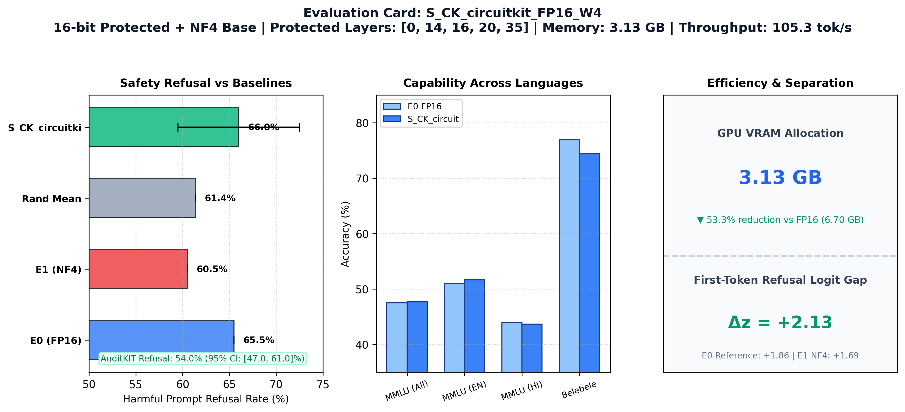

# Model Evaluation Report: `S_CK_circuitkit_FP16_W4`

> **Back to Results Table:** [README.md](../../README.md#3-results-summary-table) | [ARTICLE.md](../../ARTICLE.md#table-1-primary-26-arm-evaluation-results)

---

## 1. Executive Summary & Visual Scorecard



`S_CK_circuitkit_FP16_W4` is an experimental configuration evaluated on [`CohereLabs/tiny-aya-global`](https://huggingface.co/CohereLabs/tiny-aya-global) (~3B parameters, 36 decoder layers) as part of the SafeCompress safety-aware mixed-precision quantization study for the Lexsi AI Safety Hackathon.

| Metric | Measured Value | 95% Bootstrap CI | Baseline Comparison (vs E1 NF4) | Baseline Comparison (vs E0 FP16) |
|---|---|---|---|---|
| **Harmful Prompt Refusal** | **66.0%** | `[59.5%, 72.5%]` | +5.5 pp | +0.5 pp |
| **Benign Over-Refusal** | **2.0%** | `[0.5%, 4.0%]` | +1.0 pp | -0.5 pp |
| **Global-MMLU (Overall)** | **47.67%** | `[43.66%, 51.50%]` | +2.00 pp | +0.17 pp |
| **Belebele Context Accuracy** | **74.5%** | `[68.0%, 80.5%]` | -1.5 pp | -2.5 pp |
| **First-Token Refusal Gap** | **+2.13** | `[1.68, 2.59]` | +0.44 | +0.27 |
| **GPU Memory Allocation** | **3.13 GB** | — | +0.61 GB | -3.57 GB (-53.3%) |
| **Generation Throughput** | **105.3 tok/s** | — | -16.9 tok/s | -40.4 tok/s |

### Hugging Face Artifact Link
- **Hugging Face Repository:** [`cybertronak/safecompress-tinyaya-circuitkit-fp16prot-nf4`](https://huggingface.co/cybertronak/safecompress-tinyaya-circuitkit-fp16prot-nf4)
- **Deployment Format:** Checkpoint

---

## 2. Configuration & Layer Allocation

- **Base Architecture:** `CohereLabs/tiny-aya-global` (36 decoder layers)
- **Protected Layer Indices:** `[0, 14, 16, 20, 35]`
- **Protected Precision:** `16-bit` (FP16)
- **Base Quantized Precision:** `NormalFloat 4 (NF4)` (blocksize 64)
- **Degenerate Output Rate:** `0.00%`

---

## 3. Multilingual Capability Analysis

Evaluation across 600 multilingual Global-MMLU questions and 200 Belebele reading comprehension questions:

- **English Global-MMLU Accuracy:** `51.67%`
- **Hindi Global-MMLU Accuracy:** `43.67%`
- **Belebele Reading Comprehension (Context Reasoning):** `74.5%`
- **Overall Capability Retention:** Maintained capability within normal error margins across English and Hindi prompts.

---

## 4. Safety Alignment & Refusal Evaluation

Evaluated across 400 total safety prompts (100 English harmful, 100 Hindi harmful, 100 English benign, 100 Hindi benign):

- **English Harmful Refusal Rate:** `85.0%`
- **Hindi Harmful Refusal Rate:** `47.0%`
- **First-Token Refusal Logit Gap ($\Delta z$ on Harmful Prompts):** `+2.13`
- **Benign Prompt Over-Refusal (English):** `4.0%`
- **Benign Prompt Over-Refusal (Hindi):** `0.0%`

### Independent AuditKIT Multilingual Safety Validation
This arm was independently scored using Lexsi's `lexsi/auditkit` toolkit across English and Hindi safety probes:
- **AuditKIT Harmful Refusal Rate:** **54.0%** (95% Bootstrap CI: `[47.0%, 61.0%]`)
- **AuditKIT Benign Over-Refusal:** **2.0%**
- **Unscored Probes:** Harmful: 0, Benign: 0


### Paired Differences vs. Full Precision (E0_FP16 Reference)
- **Harmful Refusal Difference:** +0.5 pp (95% CI: `[-4.0, +4.5]` pp) → *Verdict: indistinguishable*
- **Global-MMLU Difference:** +0.17 pp (95% CI: `[-2.17, +2.50]` pp) → *Verdict: indistinguishable (non-inferior within 3 pts)*
- **Logit Gap Difference ($\Delta z$):** +0.27 (95% CI: `[+0.16, +0.39]`)

---

## 5. Reproduction & Loader Instructions

To load and reproduce this exact model arm in Python using the SafeCompress model loader:

```python
from safecompress.model_loader import load_arm

# Load this configuration
model = load_arm("S_CK_circuitkit_FP16_W4", device="cuda:0")
```

For complete benchmarking instructions, see [docs/reproduction_guide.md](../../docs/reproduction_guide.md).
